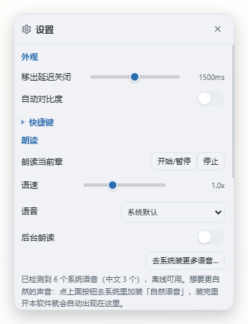
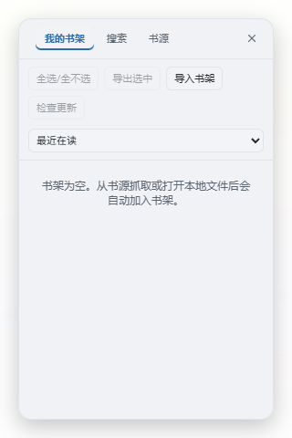

# 悬浮阅读器（浅水鲸）

一个小窗口阅读器。窗口无边框、可置顶、能调透明度，缩在屏幕角落读本地文件，
支持 TXT / EPUB / PDF / DOCX / Markdown，全部本地解析，不联网。

<p align="center">
  
</p>

<p align="center">
  
  
  
</p>

<p align="center">
  <sub>主窗口 · 工具栏 · 设置 · 书架，每个都是独立小窗，可以单独摆放</sub>
</p>

## 下载

去 [Releases](https://github.com/ryyx7193/floating-reader/releases) 下最新版，两个包选一个：

- **`Setup.x.x.x.exe`** — 安装版，装完有桌面和开始菜单快捷方式，可从「添加/删除程序」卸载
- **`floating-reader-vx.x.x-win-portable.zip`** — 免安装，解压后双击 `悬浮阅读器.exe` 直接用，不写注册表

第一次运行 Windows 会提示「未知发布者」，因为没买代码签名证书。点「更多信息 → 仍要运行」就行。

## 它能做什么

**读**

- 三种阅读模式，各自独立开关：滚动、分页、单行。分页按窗口高度切屏，一章到底就停
- 字号缩放、二十多种字体可选（思源黑体/宋体、霞鹜文楷、鸿蒙黑体、MiSans、阿里普惠体等）、浅色/深色皮肤，也能导入自定义 CSS 主题
- 窗口透明度用 `Ctrl+滚轮` 调
- **吸色**：取窗口下沿的桌面背景色自动融入，窗口不会像贴上去的一块补丁
- **朗读**：走系统语音合成，可调语速和音色

**导入与书架**

- 拖拽导入 TXT / EPUB / PDF / DOCX / Markdown，编码自动识别（UTF-8 / UTF-16 / GB18030 / Big5）
- 书架管理、封面、阅读进度、最近阅读标签栏
- 书源规则引擎：导入 JSON 规则后按站点结构抓取。**不内置任何书源**，见 [COMPLIANCE.md](COMPLIANCE.md)

**检索与标记**

- 当前章搜索 / 全文搜索
- 书签、批注。位置按章内字符偏移记录，改字号、改行距、切分页都不会丢

**窗口**

- 8 个独立面板：工具栏 / 设置 / 目录 / 搜索 / 书源 / 书架 / 书签 / 批注
- 12 个可配置全局快捷键，带冲突检测
- 一键换成办公文档 / 代码编辑器 / 数据表格三种外观（界面上这个按钮叫「伪装」，早期命名没改）
- 一键收起全部界面（界面上叫「SOS」）
- 能阻止窗口内容被截屏和录屏捕获
- 中英双语

**数据**

- 全部本地存储，章节内容 AES-GCM 加密，密钥绑定本机
- 书架和阅读数据可导出导入，可选口令加密（PBKDF2-SHA256 20 万次 + AES-GCM 256）
- 重置设置前自动备份

## 关于代码

迭代了一百多个版本，时间大头花在一件事上：怎么确认它真的没坏。

**源码是分片的。** 单文件涨到几千行就不好维护了，所以主进程和渲染层都拆了片，
由 `_build_app.js` 拼成可执行文件：

```
main-src/*.js   (16 片) ─┐
app-src/*.js    (10 片) ─┼─ node _build_app.js ─→ main.js / scripts/app.js / scripts/panel.js
panel-src/*.js   (6 片) ─┘
```

分片一共 13659 行，产物 10970 行。改完分片必须重建，不然改的是「看起来改了但没生效」的源。

**发布前有门禁。** `security-scan.js` 会扫自研代码和页面内联脚本，
九类高危模式命中就直接拦下：`eval`、`new Function`、间接 eval、`nodeIntegration: true`、
`contextIsolation: false`、`webSecurity: false`、`allowRunningInsecureContent`、
`enableRemoteModule`、放行权限请求。目前是零命中。

本地发布链有 80 段，串起静态校验、SAST、分片一致性、各轮回归、端到端探针、打包、实机冒烟。
端到端探针是真启动 Electron、用隔离的 userData、真点按钮、抓控制台错误，不是静态断言。

**做过四轮代码审查。** 安全、竞态、死代码三个方向，审完修、修完复审，最后高危清零。
修掉的问题里比较有代表性的：日志脱敏正则的回溯爆炸（4 万字符要跑 3.5 秒，改成线性扫描后 0 毫秒）、
导航白名单只按文件名后缀放行导致能被绕过、侧车队列重复结算让目标窗口收到两次关闭消息。

**敏感通道都收了口。** 能读日志、读密钥、写文件、起常驻进程、改系统设置的 IPC，
都要校验调用来源（主窗口 + 已登记的面板窗口），其余拒绝。日志在写盘入口统一脱敏，
URL 查询串、token/key/sig 键值、Bearer 头全部打码。

**依赖只有两个。** 运行时只依赖 `cheerio` 和 `iconv-lite`。EPUB / PDF / DOCX 的解析库
都本地化进了 `vendor/`，不拉 CDN，也没引入打包器或框架。

## 构建

```bash
npm install
node _build_app.js      # 从分片重建 main.js 与 scripts/*.js
npm start
npm run dist            # 打 NSIS 安装包
```

⚠️ `package.json` 里的 `build.electronDist` 指向本地 `../electron`，那是开发时用的离线缓存。
**不删这一行 `npm run dist` 会直接失败**（找不到 Electron 运行时）。你那边没这个目录的话，
把这一行删掉，让 electron-builder 自己去下载。

想跑实机自检：

```bash
npx electron tests/live-sweep.js
```

它会真启动应用，跑 67 项巡检（阅读模式、字号、面板开合、搜索、全屏、语言切换等），
并断言主窗加载的确实是本仓库页面、版本号和 `package.json` 一致。

## 改代码

```bash
git clone https://github.com/ryyx7193/floating-reader.git
cd floating-reader
npm install
node _build_app.js
npm start
```

`main-src/`、`app-src/`、`panel-src/` 是源码真源，`main.js` 和 `scripts/*.js` 是生成物。
**改分片，别改生成物。**

提交前建议跑这几个：

```bash
node tests/security-scan.js                 # 高危模式必须为 0
npx electron tests/live-sweep.js            # 67 项实机巡检
npx electron tests/resize-probe.js          # 八向拉伸
npx electron tests/rz-drag-real.js          # 拉伸事件链路
npx electron tests/support-probe.js         # 反馈与赞助入口
npx electron tests/tts-bg-probe.js          # 后台朗读（无语音环境会 SKIP）
```

发版就是打个 `v*` 的 tag 推上去，GitHub Actions 会自动构建安装包和免安装 zip 并建好 Release，
配置在 `.github/workflows/release.yml`。

## 书源与合规

**这个软件不内置任何书源。** 规则由使用者自己导入，抓取也由使用者主动触发。
请只对你有权访问的内容使用，遵守目标站点的服务条款和著作权规定。

完整边界写在 [COMPLIANCE.md](COMPLIANCE.md) 里。

## 已知限制

- 主要面向 Windows。文件关联、注册表、取色都走 Win32 API，macOS 只做了托盘模板图标这类基础适配
- 没有代码签名，SmartScreen 会提示未知发布者
- 安装包 111 MB 左右，大头是 Electron 运行时

## 反馈

有 bug 或者想提建议，去 [Issues](https://github.com/ryyx7193/floating-reader/issues)。软件里「设置 → 反馈 → 打开反馈地址」默认也指向那里。

新建 issue 时会让你选「报告问题」或「功能建议」，按模板填就行。

报之前建议先在「设置 → 反馈」点一下「导出反馈包」，它会把版本、系统信息和最近日志打成一份文本，
贴进 issue 能省不少来回。日志里的网址参数和密钥已经自动打码，可以放心贴。

也可以发邮件到 3261499309@qq.com。

## 支持

全功能免费，代码开源。如果它帮到你了：

- 爱发电：https://afdian.com/a/Audrey111
- 或者点个 ⭐、提个带复现步骤的 issue，一样有用

纯自愿，不换取任何功能特权。

## 许可

[GNU AGPL-3.0-or-later](LICENSE)。自己用、学习、改都随意；
分发改过的版本需要同样以 AGPL 开源并保留署名；想闭源商业分发的话得单独谈。

## 快捷键

| 快捷键 | 功能 |
|--------|------|
| `←` / `→` | 上一章 / 下一章 |
| `↑` `↓` `PageUp` `PageDown` `Space` | 滚动内容 |
| `Ctrl+F` | 当前章搜索 |
| `Ctrl+Shift+F` | 全文搜索 |
| `Ctrl+Shift+D` | 专注模式 |
| `Ctrl+Shift+H` | 收起全部界面 / 恢复（界面上叫「SOS」） |
| `Ctrl+Shift+P` | 取色点（自动吸色） |
| `Ctrl+Shift+T` | 打开 / 收起工具栏 |
| `Ctrl+Shift+G` | 打开目录 |
| `Ctrl+Shift+M` | 在当前位置加书签 |
| `Ctrl+Shift+S` | 内容保护（防截屏）开关 |
| `Ctrl+Shift+L` | 开始 / 暂停朗读 |
| `Ctrl+Shift+0` | 重置阴影强度 |
| `Ctrl+滚轮` | 窗口透明度 |
| `T` | 切换文本选择（复制） |
| `?` | 快捷键帮助 |
| 双击 / 三击文本区 | 进入专注模式 / 隐藏窗口 |

除保留键外都能在「设置 → 快捷键」里改，冲突会提示并拒绝。

## 更新日志

见 [CHANGELOG.md](CHANGELOG.md)。
