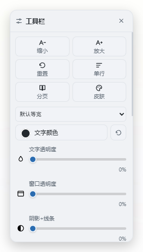

# 悬浮阅读器（浅水鲸）

> A lightweight always-on-top reading window for Windows, built with Electron.
> 轻量、可悬浮、能融入桌面的本地阅读器。

一个常驻桌面的小型阅读窗口。无边框、可拖动缩放、能透明融入背景，读本地文件而不打扰手头的事。
支持 TXT / EPUB / PDF / DOCX / Markdown，全部在本地解析，不依赖在线服务。

<p align="center">
  
</p>

<p align="center">
  
  
  
</p>

<p align="center">
  <sub>主窗口 · 工具栏 · 设置 · 书架（每个都是独立小窗，可单独摆放）</sub>
</p>

## 它解决什么问题

普通阅读器要么全屏独占，要么窗口边框笨重。这个项目的取舍是：**窗口小、能悬浮、能融进当前桌面**，
并且把「不想被打断」当成一等需求——窗口可以低调、可以一键收起、可以随背景色自动变色。

## 功能

**阅读**
- 无边框透明悬浮窗，置顶、拖动、缩放，最小 200×90
- 三种阅读模式各自独立开关：**滚动 / 分页 / 单行**（分页按窗口高度切屏，一章到底即止）
- 字号放大 / 缩小 / 一键重置；14 种中文字体；浅色 / 深色皮肤
- 自定义 CSS 主题，可保存多套并导入导出
- 窗口透明度（`Ctrl+滚轮`）
- **吸色**：取窗口下沿的桌面背景色并自动融入，窗口不再像贴上去的补丁
- **朗读**：调用系统语音合成，可调语速与音色

**导入与书架**
- 拖拽导入 TXT / EPUB / PDF / DOCX / Markdown
- 编码自动识别（UTF-8 / UTF-16LE/BE / GB18030 / Big5）
- 书架管理、封面、阅读进度、最近阅读标签栏
- 书源规则引擎：导入 JSON 规则后按站点结构抓取（**不内置任何书源**，见 [COMPLIANCE.md](COMPLIANCE.md)）

**检索与标记**
- 当前章搜索 / 全文搜索
- 书签、批注。位置用**章内字符偏移**记录，改字号、改行距、切换分页都不会丢

**窗口与交互**
- 8 个独立小窗面板：工具栏 / 设置 / 目录 / 搜索 / 书源 / 书架 / 书签 / 批注
- 12 个可配置全局快捷键，带冲突检测
- **低调外观**：一键把窗口换成办公文档 / 代码编辑器 / 数据表格三套外观（界面上这个按钮叫「伪装」，
  是历史命名）；**快速隐藏**一键收起全部界面（界面上叫「SOS」）
- **内容保护**：阻止窗口内容被截屏与录屏捕获
- 中英双语，切换覆盖主窗与全部面板

**数据**
- 全部本地存储（IndexedDB + localStorage），章节内容 AES-GCM 加密，密钥绑定本机
- 书架 / 阅读数据导出导入，可选口令加密（PBKDF2-SHA256 20 万次 + AES-GCM 256）
- 重置设置前自动备份

## 工程上值得说的部分

这个项目迭代了 100+ 个版本，重心一直在「怎么证明它真的没坏」上。

**分片源码 + 构建拼接**
单文件膨胀到几千行后维护成本会失控，所以主进程与渲染层都拆成分片，由 `_build_app.js` 拼成可执行文件：

```
main-src/*.js   (16 片) ─┐
app-src/*.js    (10 片) ─┼─ node _build_app.js ─→ main.js / scripts/app.js / scripts/panel.js
panel-src/*.js   (6 片) ─┘
```

分片共 13659 行，产物 10970 行。改分片后必须重建，否则改的是「看起来改了但没生效」的源。

**0 高危的静态基线**
`security-scan.js` 在打包前扫描自研代码与页面内联脚本，9 类高危模式（`eval` / `new Function` /
间接 eval / `nodeIntegration: true` / `contextIsolation: false` / `webSecurity: false` /
`allowRunningInsecureContent` / `enableRemoteModule` / 放行权限请求）**命中即阻断发布**。
当前基线为零，任何回归都会被拦下。

**80 段发布链 + 75 个门禁脚本**
一次发布串起：静态校验 → SAST → 分片一致性 → 各轮回归 → 端到端探针 → 打包 → 实机冒烟。
其中端到端探针是真启动 Electron、用隔离的 `userData`、真点按钮、抓控制台错误，不是静态断言。

**4 轮独立代码审查**
安全 / 竞态 / 死代码三个维度做了 4 轮「审查 → 修复 → 复审」循环，最终独立终审 P0/P1 清零。
过程中修掉的真问题包括：日志脱敏正则的 ReDoS（4 万字符 3.5 秒 → 0 毫秒）、
导航白名单只按文件名后缀放行导致的绕过、侧车队列重复结算导致目标窗口收到两次关闭消息。

**IPC 权限收口**
所有能读日志、读密钥、写文件、起常驻进程、改系统设置的通道，都校验调用来源
（主窗口 + 已在册的面板窗口），其余一律拒绝。日志在**写盘入口**统一脱敏，
URL 查询串、`token/key/sig` 键值、`Authorization: Bearer` 全部打码。

**依赖极少**
运行时只有 `cheerio` 和 `iconv-lite` 两个依赖。EPUB / PDF / DOCX 的解析库全部本地化进 `vendor/`，
不联网拉 CDN，也不引入打包器或框架。

## 构建

```bash
npm install
node _build_app.js      # 从分片重建 main.js 与 scripts/*.js
npm start               # 本地运行
npm run dist            # 打 NSIS 安装包
```

> ⚠️ `package.json` 的 `build.electronDist` 指向本地 `../electron` 目录（本项目开发时的离线缓存）。
> 你的环境没有这个目录，**删掉 `electronDist` 这一行**，让 electron-builder 自己下载对应版本即可。

实机自检：

```bash
npx electron tests/live-sweep.js
```

## 参与开发

```bash
git clone <本仓库地址>
cd floating-reader
npm install
node _build_app.js      # 改完分片必须重建，否则改的是"看起来改了但没生效"的源
npm start
```

**目录约定**：`main-src/`（主进程 16 片）、`app-src/`（渲染层 10 片）、`panel-src/`（面板 6 片）
是源码真源，`main.js` 与 `scripts/*.js` 是 `_build_app.js` 的生成物。**改分片，不改生成物。**

**提交前建议跑**：

```bash
node tests/security-scan.js                 # 高危模式必须为 0
npx electron tests/live-sweep.js            # 67 项实机巡检
npx electron tests/resize-probe.js          # 八向拉伸
npx electron tests/rz-drag-real.js          # 拉伸事件链路
npx electron tests/support-probe.js         # 反馈与赞助入口
npx electron tests/tts-bg-probe.js          # 后台朗读（无语音环境会 SKIP）
```

发版：打一个 `v*` tag 推上去，GitHub Actions 会自动构建 Windows 安装包与免安装 zip 并创建 Release
（见 `.github/workflows/release.yml`）。

会真启动应用、跑 67 项功能巡检（阅读模式 / 字号 / 面板开合 / 搜索 / 全屏 / 语言切换等），
并断言主窗加载的是本仓库页面、版本号与 `package.json` 一致。

## 书源与合规

**本项目不内置任何书源。** 书源规则由使用者自行导入，抓取行为由使用者主动触发。
请只对你有权访问的内容使用该功能，并遵守目标站点的服务条款与著作权规定。

完整边界见 [COMPLIANCE.md](COMPLIANCE.md)。

## 已知限制

- 主要面向 Windows（文件关联、注册表、取色走 Win32 API）；macOS 仅有托盘模板图标等基础适配
- 未做代码签名，Windows SmartScreen 会提示未知发布者
- 安装包约 116 MB（Electron 运行时占大头）

## 反馈与支持

**遇到问题**（按推荐顺序）：

1. **GitHub Issues** — https://github.com/ryyx7193/floating-reader/issues
   软件里「设置 → 反馈 → 打开反馈地址」默认就指向这里。
2. **邮件** — 3261499309@qq.com
3. **报之前先导出诊断**：设置 → 反馈 →「导出反馈包」，会把版本、平台、最近日志打成一份文本。
   贴进 issue 能省掉一半来回。日志里的 URL 查询串与凭据已自动打码，可以放心贴。

**想支持这个项目**：

代码全部开源，功能不设付费墙。如果它对你有用：

- **爱发电**（推荐，有公开主页和赞助记录）：https://afdian.com/a/Audrey111
- **微信 / 支付宝赞赏码**（零手续费）：
  <!-- TODO 把两张收款码图片放到 assets/donate/ 下，再取消下面两行的注释。
       注意：收款码会公开在仓库里，任何人都能看到。介意的话只放爱发电链接即可。 -->
  <!--
  
  
  -->
- **GitHub Sponsors**：暂未开通（需要 Stripe 账户，大陆个人主体较难申请）
- 或只是点个 ⭐ / 提一个带复现步骤的 issue，同样有价值

> 赞助是纯自愿的支持，**不换取任何功能特权，也不构成服务承诺**。
> 软件里的「设置 → 反馈 → 支持开发」指向同一个入口（`CONFIG.SUPPORT_URL`）。

## 许可

[GNU AGPL-3.0-or-later](LICENSE)。

- 个人自用、学习、修改、二次开发：**完全自由**
- 分发修改版或衍生作品：必须同样以 AGPL 开源，并保留原作者署名
- 闭源商业分发：需单独获得授权

## 快捷键

| 快捷键 | 功能 |
|--------|------|
| `←` / `→` | 上一章 / 下一章 |
| `↑` `↓` `PageUp` `PageDown` `Space` | 滚动内容 |
| `Ctrl+F` | 当前章搜索 |
| `Ctrl+Shift+F` | 全文搜索 |
| `Ctrl+Shift+D` | 专注模式 |
| `Ctrl+Shift+H` | 快速隐藏 / 恢复全部界面（界面标注「SOS」） |
| `Ctrl+Shift+P` | 取色点（自动吸色） |
| `Ctrl+Shift+T` | 打开 / 收起工具栏 |
| `Ctrl+Shift+G` | 打开目录 |
| `Ctrl+Shift+M` | 在当前位置加书签 |
| `Ctrl+Shift+S` | 内容保护（防截屏）开关 |
| `Ctrl+Shift+L` | 开始 / 暂停朗读 |
| `Ctrl+Shift+0` | 重置阴影强度 |
| `Ctrl+滚轮` | 窗口透明度 |
| `T` | 切换文本选择（复制） |
| `?` | 快捷键帮助 |
| 双击文本区 / 三击文本区 | 进入专注模式 / 隐藏窗口 |

除保留键外均可在「设置 → 快捷键」修改，冲突会提示并拒绝。

## 更新日志

见 [CHANGELOG.md](CHANGELOG.md)。
